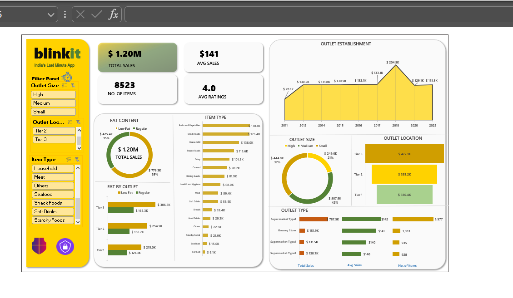

<h1 align="center">Hi there, I'm Josh 👋</h1>

<h3 align="center">
  Aspiring Data Analyst | Microsoft Excel Enthusiast
</h3>

  Transforming raw data into meaningful insights through
  data analysis, visualization, and interactive dashboards.

  📍 Kenya | 📊 Data Analytics | 📈 Excel Dashboard Development

---

## 👨‍💻 About Me

**🙋🏼‍♂️ Developer:** [Njoroge Maina](https://www.linkedin.com/in/)

Hello! I'm Josh, an aspiring Data Analyst passionate about
exploring data, identifying trends, and transforming raw
information into meaningful insights.

I enjoy working with Microsoft Excel to analyze datasets,
create interactive dashboards, visualize business performance,
and communicate findings effectively.

Through practical projects, I have developed hands-on
experience using Excel and its relevant tools to solve
business-related analytical problems.

My goal is to continuously improve my analytical skills
and grow into a professional Data Analyst.

### 🎯 Areas of Interest

- Data Analysis and Exploration
- Microsoft Excel
- Interactive Dashboard Development
- Data Visualization
- Business Intelligence
- Data Storytelling
- Continuous Learning
 
---

## 🛠️ Tools & Technologies

The following Microsoft Excel features and tools were
used in developing my projects.

| Tool | Application |
|---|---|
| Microsoft Excel | Data analysis and dashboard development |
| Pivot Tables | Data summarization and analysis |
| Pivot Charts | Visual representation of summarized data |
| Power Query | Dashboard data Cleaning|
| Slicers | Interactive dashboard filtering |
| Timelines | Date-based data filtering |
| Excel Charts | Data visualization and comparison |
| KPI Cards | Displaying important business metrics |
| Conditional Formatting | Improving data presentation |
| Excel Formulas | Calculations and data analysis |
| Excel Formatting | Dashboard design and presentation |

---

## 🚀 My Learning Goals

I believe in continuous learning and improving my
analytical abilities through practical projects.

My future learning goals include:

- [ ] Improve my advanced Microsoft Excel skills.
- [ ] Work with more complex datasets.
- [ ] Develop more interactive dashboards.
- [ ] Learn SQL for database analysis.
- [ ] Learn Power BI for advanced visualization.
- [ ] Learn Python for data analysis.
- [ ] Build more real-world data analytics projects.

## 🤝 Let's Connect!

I'm open to connecting with fellow data enthusiasts,
professionals, recruiters, and anyone interested in
data analytics.

I'm always excited to learn, collaborate, share ideas,
and explore new opportunities.

  

  

  

---

  ⭐ Thank you for visiting my GitHub portfolio!

  <i>Learning, analyzing, visualizing, and growing one project at a time. 🚀</i>

