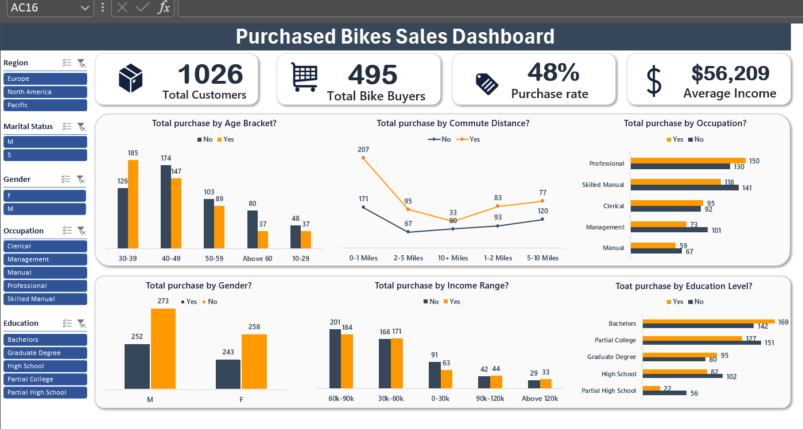
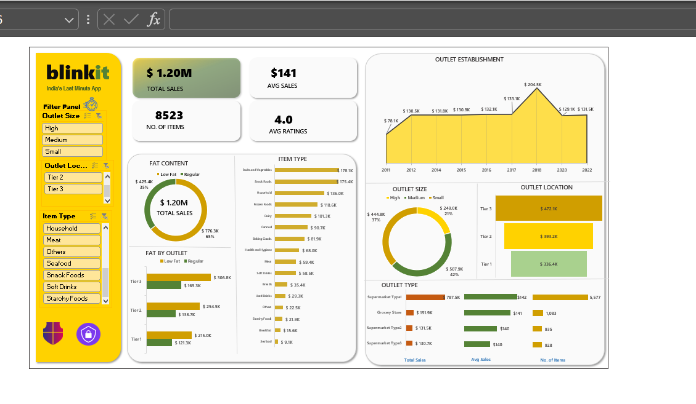
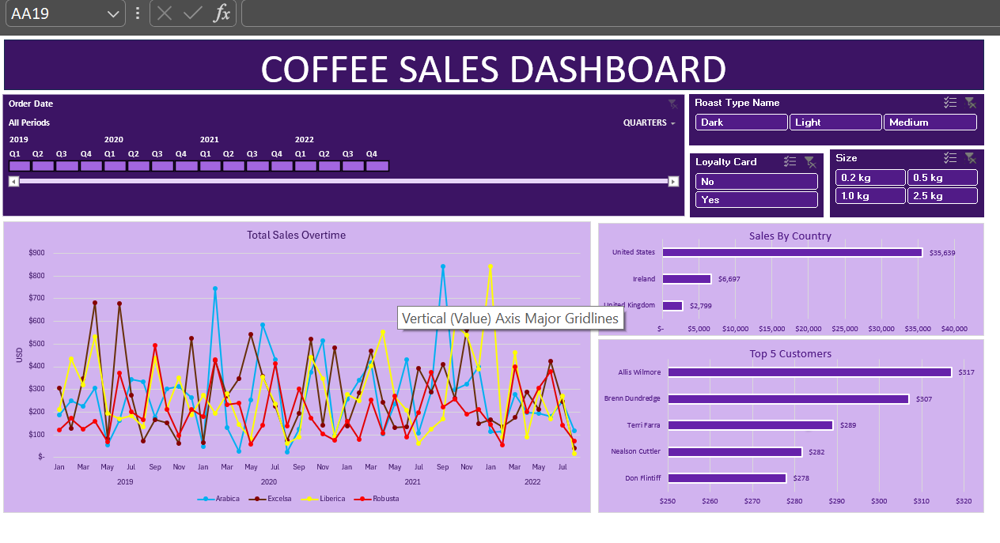
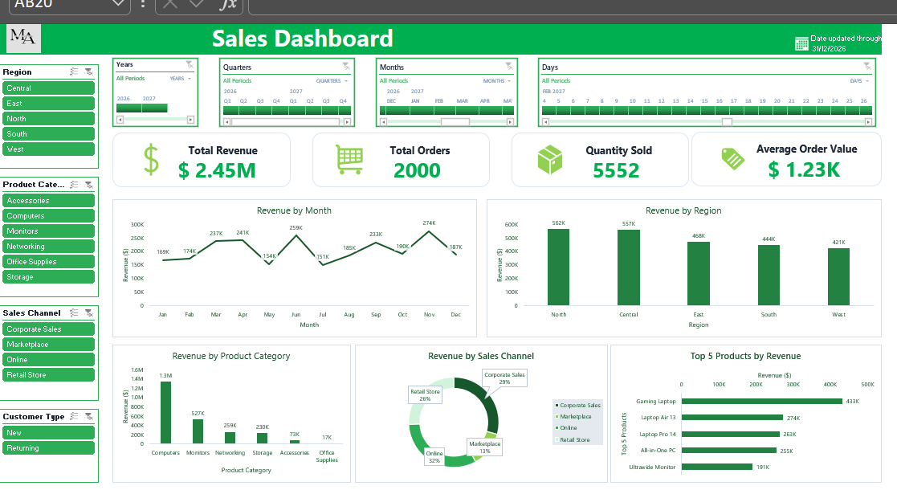

## 📂 My Data Analytics Projects

Here are three practical projects I have completed using
Microsoft Excel.

### 🚲 1. Bike Purchases Sales Dashboard

**Project Overview**

This project analyzes customer purchasing behavior to
understand the factors associated with bike purchases.

I developed an interactive Excel dashboard to explore
customer demographics, income levels, occupations,
and commuting distances.

**Key Performance Indicators (KPIs)**

- Total Customers: 1,026
- Total Bike Buyers: 495
- Purchase Rate: 48%
- Average Income: $56,209

**Dashboard Analysis**

- Bike purchases by age bracket.
- Purchases by commute distance.
- Purchases by occupation.
- Purchases by gender.
- Purchases by income range.
- Purchases by education level.

**Excel Tools Used**

- Pivot Tables
- Pivot Charts
- Slicers
- KPI Cards
- Bar Charts
- Line Charts
- Dashboard Formatting

**Skills Demonstrated**

- Customer behavior analysis.
- Data summarization.
- Interactive reporting.
- Data visualization.
- Business insight presentation.

**Dashboard Preview**

  

  [View Full Dashboard](https://1drv.ms/x/c/d5a91b2e75da4ef6/IQBS6I_iCA5JQokL6cM5F6t1AQOXjeEKrNYki2Hso3NHMss?e=sGjfWb)

---

### 🛒 2. Blinkit Sales Analysis Dashboard

**Project Overview**

This project focuses on analyzing Blinkit outlet sales
data to understand sales performance across different
product categories, outlet sizes, and locations.

I created an interactive Excel dashboard to present
important business metrics and compare outlet performance.

**Key Performance Indicators (KPIs)**

- Total Sales: $1.20M
- Average Sales: $141
- Number of Items: 8,523
- Average Rating: 4.0

**Dashboard Analysis**

- Sales by fat content.
- Sales by item type.
- Sales by outlet size.
- Sales by outlet location.
- Sales by outlet establishment year.
- Sales by outlet type.

**Excel Tools Used**

- Pivot Tables
- Pivot Charts
- Slicers
- KPI Cards
- Doughnut Charts
- Bar Charts
- Area Charts
- Dashboard Formatting

**Skills Demonstrated**

- Sales performance analysis.
- Product category analysis.
- Business reporting.
- Comparative analysis.
- Interactive dashboard development.

**Dashboard Preview**

 

 [View Full Dashboard](https://1drv.ms/x/c/d5a91b2e75da4ef6/IQC49IF3zj2iTahVwRprM0Q-AS7wsn_sUug9YXB0Lc22k40?e=s87I0h)
---

### ☕ 3. Coffee Sales Dashboard

**Project Overview**

This project explores coffee sales performance from
2019 to 2022.

The dashboard focuses on sales trends, customer
contributions, country performance, coffee roast types,
and product sizes.

I developed an interactive Excel dashboard to make
sales performance easier to monitor and understand.

**Dashboard Analysis**

- Total sales over time.
- Sales by country.
- Top 5 customers.
- Sales by coffee roast type.
- Sales by coffee size.
- Loyalty card analysis.
- Quarterly sales performance.

**Excel Tools Used**

- Pivot Tables
- Pivot Charts
- Slicers
- Timelines
- KPI Cards
- Line Charts
- Bar Charts
- Dashboard Formatting

**Skills Demonstrated**

- Time-based data analysis.
- Sales trend analysis.
- Customer segmentation.
- Performance comparison.
- Data visualization.
- Interactive reporting.

**Dashboard Preview**
    

 ### [View Full Dashboard](https://1drv.ms/x/c/d5a91b2e75da4ef6/IQAqve45USCZToDJhynzFrWhAV20g6L9OyHtr7fv1qtpKXg?e=cJEf3s)

---

## 📚 Skills Gained

Through these projects, I have gained practical experience
in different areas of data analytics.

### 📊 Data Analysis
- Exploring and understanding datasets.
- Summarizing information.
- Identifying trends and patterns.
- Comparing data across categories.
- Interpreting business performance.

### 📈 Data Visualization
- Creating meaningful charts.
- Selecting appropriate chart types.
- Presenting information clearly.
- Comparing business metrics visually.
- Communicating findings through dashboards.
**Dashboard Preview**
    

 ### [View Full Dashboard](https://1drv.ms/x/c/d5a91b2e75da4ef6/IQA6bGFGYJ4zR5lG2krqwVEBAWTqD0EU90cABrGJSMIfk4A?e=R105bj)
### 📑 Excel Dashboard Development
- Building interactive dashboards.
- Creating KPI cards.
- Using Pivot Tables and Pivot Charts.
- Connecting slicers to dashboard reports.
- Applying timelines for date filtering.
- Designing organized dashboard layouts.

### 🧠 Analytical Thinking
- Understanding business questions.
- Exploring data from different perspectives.
- Identifying useful patterns.
- Comparing performance indicators.
- Transforming data into meaningful insights.

### 🎨 Dashboard Design
- Organizing dashboard elements.
- Applying consistent colors and formatting.
- Improving readability.
- Creating user-friendly reports.
- Presenting information effectively.

---

## 💡 Key Lessons Learned

Working on these projects has helped me understand
that data analysis is more than just working with numbers.

It involves understanding information, identifying
meaningful patterns, and presenting findings in a way
that supports decision-making.

Some important lessons I have learned include:

- Clean and organized data makes analysis easier.
- The right chart helps communicate information effectively.
- Interactive slicers improve dashboard usability.
- KPIs provide quick summaries of business performance.
- Good dashboard design improves data interpretation.
- Practical projects are essential for developing analytical skills.

---
[Back to Profile README](/README.md)
